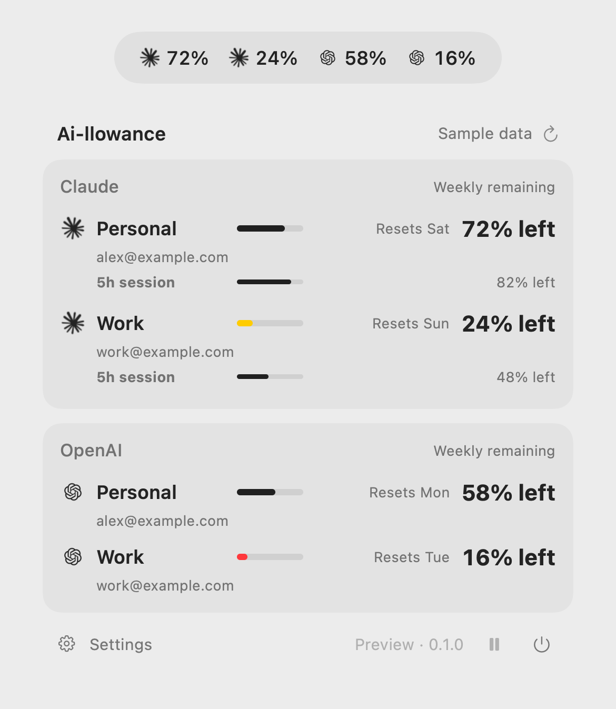

# Ai-llowance

*Know what’s left.*

A small native macOS menu bar app for AI allowances, API budgets, and credits across your accounts. SwiftUI + AppKit, Foundation networking, Security Keychain; Sparkle for signed app updates; no Electron. Requires macOS 14+ and Swift 6 to build.

**0.3.0 preview — not a production release.** The DMG includes Apple Silicon and Intel binaries and is ad-hoc signed, not Developer ID signed or notarized. Claude's CLI usage format is version-dependent. See [verification](docs/verification.md) for tested behavior and remaining limits.

<picture>
  <source media="(prefers-color-scheme: dark)" srcset="docs/images/menu-dark.png">
  
</picture>

*Fictional accounts and readings. [Privacy policy](PRIVACY.md).*

## Install

1. For subscription readings, install [Claude Code](https://code.claude.com/docs/en/setup), [Codex CLI](https://developers.openai.com/codex/cli), or Copilot CLI. API credit and budget connections do not need a CLI.
2. Download the DMG from [GitHub Releases](https://github.com/jamesatFRM/Ai-llowance/releases), open it, and drag **Ai-llowance** onto **Applications**. Eject the disk image and open the installed app.
3. Open Ai-llowance. Its icon appears in the menu bar; **Settings** manages connections.

macOS may block the preview because it is not notarized. Review the source and release checksum before deciding whether to allow it through **System Settings → Privacy & Security → Open Anyway**. Follow [Apple's guidance](https://support.apple.com/102445); do not disable Gatekeeper globally. You can also build from source below.

The app targets macOS 14 or later. The DMG is universal (Apple Silicon and Intel); native Intel runtime verification and all macOS versions have not been tested. No Apple developer membership is needed to build locally.

To check a download, place its `SHA256SUMS` file beside the downloads and run `shasum -a 256 -c SHA256SUMS`. **Settings → Updates → Check for Updates…** downloads verified releases and offers **Install and Relaunch**. Automatic checks run daily by default and can be disabled; installation waits for your choice. Account settings remain in Application Support. Version 0.1.0 needs this one-time DMG installation to gain the updater. Login at startup is not enabled automatically.

## Connect once

Open **Settings**, choose a connection, and follow the setup card. The first successful fresh reading confirms the connection. Installed tools are detected again when you return; custom tool locations can be remembered until the file changes.

- **Claude:** detects your existing Claude Code subscription sign-in. If needed, opens Claude's own browser login through a short Terminal launcher. Once sign-in completes, close Terminal: no conversation, test prompt, or persistent Terminal session is needed. Additional accounts use separate profiles.
- **OpenAI:** opens ChatGPT sign-in in your browser for a separate Codex profile. **More connection options → Use my existing OpenAI / Codex sign-in** connects the current CLI account instead. For sign-in recovery, **Use another browser profile** prepares a link without opening the default browser. While waiting, **Copy sign-in link** lets you complete authorization in the matching Chrome profile without switching your other browser account.
- **Copilot (preview):** uses the currently signed-in Copilot CLI account and its quota report, without starting a chat.
- **Credits and budgets:** enter a Vercel AI Gateway key, OpenRouter key, or xAI Management key and team ID in Settings. These are API balances or budgets, separate from consumer subscriptions.
- **API spending:** optional under **More connection options**. Requires an organization Admin API key stored in Keychain. Subscription login is separate from API billing.

The CLIs must be installed once; common installation locations are detected, with official installation links and file pickers when needed. Ai-llowance never downloads executables automatically.

## What the numbers mean

| Connection | Displays | Source |
|---|---|---|
| OpenAI Codex subscription | Weekly and session quota windows, plus weekly reset weekdays | Official local Codex app-server |
| Claude subscription | Weekly, five-hour, and any model-specific weekly limits returned | Installed Claude Code's built-in `/usage` command |
| OpenAI API | Organization costs this UTC month | Official Admin Costs API |
| Anthropic API | Organization costs this UTC month, excluding Priority Tier | Official Admin Cost Report API |
| Copilot (preview) | Premium interaction quota; explicit unlimited state when reported | Installed Copilot CLI account quota RPC |
| OpenRouter | Configured key/effective spending budget remaining | Official current-key endpoint; not total account credits |
| Vercel AI Gateway | Team API credits | Official Gateway credits endpoint |
| xAI (beta) | Team API prepaid credits | Official Management billing endpoint; not Grok subscription quota |

Percentages are labeled **left**. The compact row and menu bar show the lowest applicable overall allowance, so an empty session is visible even if weekly allowance remains. Expand a row for individual limits, reset countdowns, the reading age, and a small recent-history graph. Model-specific Claude rows stay in details. A verified unlimited quota displays ∞. Missing readings retain the requested 0% fallback with a warning; they never count as verified zero allowance. Up to three attention items lead directly to the account that needs help.

Optional quiet alerts notify you when fresh quota crosses low/empty thresholds or recovers after exhaustion. They are off initially, deduplicated, and combined per refresh. Cached readings never generate alerts. You can also enable Launch at Login in Settings.
Choose Automatic, Light, or Dark appearance in Settings. Automatic follows macOS. Provider icons use native monochrome templates on transparent backgrounds.

The menu bar can show an average across all accounts, one average per provider, or individual accounts. Individual-account mode keeps Claude accounts together, followed by OpenAI accounts, preserving order within each provider. It can hide names for just provider icons and percentages; hover to identify accounts. Include all accounts or select specific ones. Averages give each account equal weight, regardless of plan size; they do not represent pooled credits. Each subscription uses its most limiting applicable allowance in menu-bar summaries. API dollar balances are shown separately in the popover and are never averaged with percentages. Missing, failed, stale, or provider-restricted accounts make their group unavailable instead of being silently excluded.

Opening the menu or Settings requests a new reading, capped at one healthy network read per 30 seconds. Subscription reads run about once a minute while the interface is open and every ten minutes when closed (fifteen in Low Power Mode). API balances use slower checks; organization spending is hourly. One coalescible timer schedules due work, with serial provider reads and failure backoff. Sleeping, pausing, and offline status stop network reads. Old/error readings are visibly marked; reset times never fabricate replenished quota. Clicking outside the menu dismisses it. Pause/resume and Quit are direct icon buttons.

Codex reports Codex's buckets, not a universal ChatGPT allowance. The Claude report is a direct plan-usage query, so usage elsewhere on that subscription can be reflected without another Claude Code conversation. It is still a point-in-time provider report, not a continuous live counter.

API spending is **not a remaining credit balance**. Cursor and Gemini have usage-page shortcuts; automatic quota readings were not verified. Workspace ownership does not establish Gemini CLI allowance. xAI prepaid API credits do not describe a Grok subscription. No balance is estimated from a spending total. See [provider boundaries](docs/providers-0.3.md).

## Claude reliability and boundaries

Direct Claude usage was verified with **Claude Code 2.1.294** in local verification. Ai-llowance runs the exact built-in `/usage` command in print mode with safe mode, tools/MCP disabled, and session persistence disabled. The verified command returned **zero model turns and zero model cost**. Credentials stay inside Claude's own authentication system; no OAuth token extraction or private consumer API calls are implemented.

The JSON envelope is structured, but its plan rows are text. This is a version-dependent CLI integration, not a published external quota API. Ai-llowance accepts only recognized plan rows, requires a successful zero-turn/zero-cost report, excludes behavioral attribution percentages, rejects last-known/rate-limited reports as fresh data, and fails clearly if a CLI version changes the output. Update Claude Code if it does not return plan percentages in print mode.

The previous status-line bridge is no longer needed. After a successful direct read, the app restores the pre-Ai-llowance status line only if its own setting is still present. Later user edits survive. New connections do not change status-line settings.

## Security and footprint

See the [hardening and resource report](docs/hardening-and-resources.md) for measurements and verification limits. The native app is small, but short-lived provider CLIs add CPU and memory during refresh; “extremely lightweight” is not a claim about the entire process tree.

- One coalescible timer, adaptive intervals, and serial reads. Claude and Codex run short-lived CLI children; there is no persistent background agent or inference loop.
- Network/API credentials are never logged. Claude's full local usage report stays in memory; only plan rows become app state. No transcript contents are read by Ai-llowance.
- API keys use this Mac's non-synchronizing Keychain. New Codex profiles require Keychain with no plaintext fallback.
- Claude owns its credentials. For new isolated Claude profiles, the login launcher detects Claude's possible plaintext fallback, logs out, removes that app-owned fallback, and stops until Keychain is available. Existing profiles retain Claude's credential-storage policy.
- API requests are GET-only to fixed official origins, with redirects rejected. Ai-llowance has no analytics, cookies, or backend service. Processes it launches disable supported Claude telemetry/error reporting and Codex analytics/feedback. Provider services still handle authentication and quota requests; see the [privacy policy](PRIVACY.md).
- Removing an app-owned OpenAI account logs it out. Claude sign-ins remain CLI-managed; use **More → Sign out in Terminal** before removal if desired.
- Each account can open links in a selected Chrome profile. The profile must already exist; this app does not change browser sign-ins or read cookies. With Default browser selected, links use that browser's current account.
- Last readings and bounded history are saved privately for instant startup. Saved readings retain their original timestamp and are marked until refreshed; account changes clear them. History is capped at 96 samples per account and seven days, sampled no faster than every five minutes.

Local settings live under `~/Library/Application Support/UsageBar`. The original storage folder, bundle identity, and Keychain service are intentionally retained so existing accounts and preferences survive the rename. The development app is not App Sandbox enabled because it launches installed CLIs. Stable Developer ID signing is recommended before distribution.

## Build and test

```sh
bash scripts/test.sh
bash scripts/build-app.sh
open dist/Ai-llowance.app
```

The locally built `Ai-llowance.app` opens directly. Close Settings to keep it in the menu bar; the power icon quits the app. Preview fixtures never replace real account data:

```sh
# Quit any running Ai-llowance instance first.
open dist/Ai-llowance.app --args --preview
```

Export shareable PNGs with fictional emails and readings in both appearances (no live account data is loaded):

```sh
dist/Ai-llowance.app/Contents/MacOS/UsageBar --export-preview ./share-images
```

The export reuses the actual dashboard rows without its scroll container, which cannot be captured by SwiftUI's image renderer. The menu strip illustrates the same ordered entries as the native menu bar.

Optional isolated dummy-Keychain test:

```sh
USAGEBAR_TEST_KEYCHAIN=1 bash scripts/test.sh --filter keychainRoundTripWhenExplicitlyEnabled
```

Read-only live probes (use your installed CLI paths):

```sh
swift run UsageBridge --probe-codex /opt/homebrew/bin/codex
swift run UsageBridge --probe-claude "$HOME/.local/bin/claude"
```

`UsageCore` defines adapters, typed quota windows, timestamps, errors, polling policy, and credential storage. Future providers should expose only verified data, with explicit unsupported states. Provider scopes, official sources, and live-verification limits are in [providers-0.3.md](docs/providers-0.3.md).


To produce an ad-hoc signed DMG, ZIP and checksums:

```sh
bash scripts/package-release.sh
```

## Troubleshooting

- **No quota / sign-in needed:** use Accounts to sign in again. Subscription sign-in and API keys are different connection types.
- **Claude report not supported:** update Claude Code. The integration was verified with 2.1.294; older versions may not return subscription limits in print mode. Unsupported data remains unavailable.
- **Stale or rate-limited:** wait for provider backoff. Refresh intentionally cannot bypass a provider's wait instruction.
- **Wrong account on the website:** choose the matching Chrome profile for that account in Settings, or copy the sign-in link into it. Compare the signed-in identity shown in Ai-llowance.
- **CLI not detected:** use More connection options to choose the executable. Choose Remember this location to retain a custom path. If the file changes, select it again or use the detected installation.
- **Keychain locked:** unlock the login Keychain, then reconnect or refresh. Ai-llowance does not store API keys in plaintext.
- **Removing an account:** see [security and removal](SECURITY.md). Claude sign-ins are managed by Claude; removing the app alone does not sign them out.

Bug reports should include app/macOS/CLI versions and reproducible steps, with emails, keys, and account details removed. See [contributing](CONTRIBUTING.md) and [release notes](CHANGELOG.md).

## License and affiliation

[MIT](LICENSE). Ai-llowance is an independent project and is not affiliated with or endorsed by its supported providers. Provider names identify the services it connects to.

Provider logos belong to their respective owners and are excluded from the MIT license. See [third-party notices](THIRD_PARTY_NOTICES.md).

### Connection recovery

- A current signed-in Claude subscription can be reused. A logged-out or API-billed Claude CLI gets a separate subscription profile, leaving the original profile untouched.
- During sign-in the account says **Finish sign-in in your browser**. Claude completion is detected on the next local check (normally within 15 seconds), so it does not wait through an earlier authentication backoff. Unfinished Claude attempts stop waiting after ten minutes; close their Terminal window before retrying. Codex browser login can be cancelled in the app and times out after five minutes.
- Expired sign-ins show **Sign in** even if the last reading is still visible. Existing Codex CLI profiles are reauthenticated in Codex, then **Check sign-in** rereads them. Missing or unauthorized API credentials show **Replace key**.
- Claude and Codex connections bind to the first verified email. A later CLI account switch shows a sign-in issue rather than another account’s allowance. A second connection to an already connected email is rejected from quota totals and can be signed in with a different account. Same-email organization identities are not distinguishable through this email binding; no connection is automatically deleted, merged, or signed out.
- Provider outages and rate limits retain their backoff. A late response from before a reconnect cannot replace the new connection state.

## Release updates

Pushes to `main` run privacy, test, universal-build, and DMG checks. When automated publishing is enabled, the publish job runs after those checks and uses the encrypted `SPARKLE_PRIVATE_KEY` repository secret to publish a new preview release and its signed update feed. Pull requests cannot access the signing key or publish releases. Each CI run has a higher build number, including when the display version stays the same. Increment `VERSION` for named releases. The exact Sparkle dependency and packaging tools are pinned.

Update archives and the feed use Ed25519 signatures. The app verifies the feed and archive before extraction; no unsigned fallback or system profiling is enabled. The signing key stays in the maintainer's Keychain. Automated publishing additionally requires approval to store it in an encrypted GitHub Actions secret; the key is never in source or downloads. See [release maintenance](docs/releases.md).
